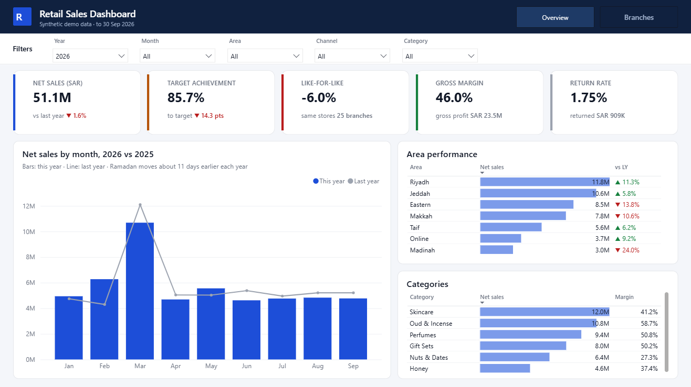
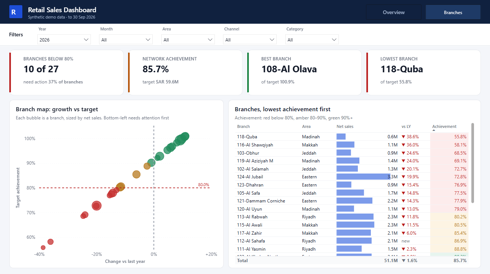

# Retail Sales Dashboard (Power BI, synthetic data)

A two-page Power BI report for a retail chain: sales vs last year, like-for-like, target achievement, margin and returns, and which branches need attention first. It is built on an invented chain of 26 branches in 6 areas plus an online store, with about 585K sales lines from January 2024 to September 2026. **Every name and number is made up.**

The measures are the ones I use at work on real retail data.

- **Live web version:** https://mohamed-elsonbaty.github.io/dashboard.html
- **Portfolio:** https://mohamed-elsonbaty.github.io





## What the report answers

| Page | Question | How |
| --- | --- | --- |
| Overview | Are we ahead of last year and on target? | KPI cards with the comparison under each number; monthly sales vs last year; area and category tables |
| Overview | Which areas are pulling the total down? | Area table with data bars and a green/red change vs last year |
| Branches | Which branches need attention first? | Branch map (growth vs target achievement, sized by sales) and a table sorted by achievement, coloured red below 80%, amber 80-90%, green 90%+ |

## Model

Star schema: one `Sales` fact table with `Branch`, `Product`, `Target` and a `Date` table. All measures sit in a `_Measures` table, in display folders.

```
Date ──< Sales >── Branch
  │        │         │
  │        └──< Product
  └──< Target >──────┘
```

| Measure | Definition |
| --- | --- |
| Net Sales | Sales after discounts and returns |
| Net Sales LY | Same dates one year earlier (`SAMEPERIODLASTYEAR`) |
| vs LY % | Growth vs last year |
| LFL % | Like-for-like: only branches open at the start of the same period last year |
| Target Achievement % | Net sales / monthly branch target |
| Branches Below 80% | Branches under 80% of target in the selected period |
| Best Branch / Lowest Branch | Highest and lowest target achievement (`TOPN`) |
| Gross Margin % | (Net sales - cost) / net sales |
| Return Rate % | Returned value / gross sales |

New branches show "new" instead of a growth figure, and they are left out of the branch map, so a branch with almost no sales last year does not read as +1000%.

## Files

| Path | What it is |
| --- | --- |
| `RetailDemo.pbix` | The report, ready to open in Power BI Desktop |
| `RetailDemo.pbip` + `RetailDemo.SemanticModel/` + `RetailDemo.Report/` | The same report as a Power BI project (TMDL model, PBIR report), readable in git |
| `generate_data.py` | Python (pandas, numpy) generator for the dataset: Ramadan, Eid and National Day seasonality, new branch openings, returns and monthly targets |
| `build_pbip.py` | Writes the Power BI project files from code |
| `data/` | `branches.csv`, `products.csv`, `targets.csv` |
| `design/` | The design mockups I chose between before building the report |

`data/sales.csv` (about 28 MB) is not in the repo. Run `python generate_data.py` to create it; it takes about 20 seconds.

## Open it

1. Run `python generate_data.py` to create `data/sales.csv`.
2. Open `RetailDemo.pbix` in Power BI Desktop.
3. Go to **Transform data > Edit parameters**, set `DataFolder` to the full path of the `data` folder (keep the trailing backslash), then **Refresh**.
